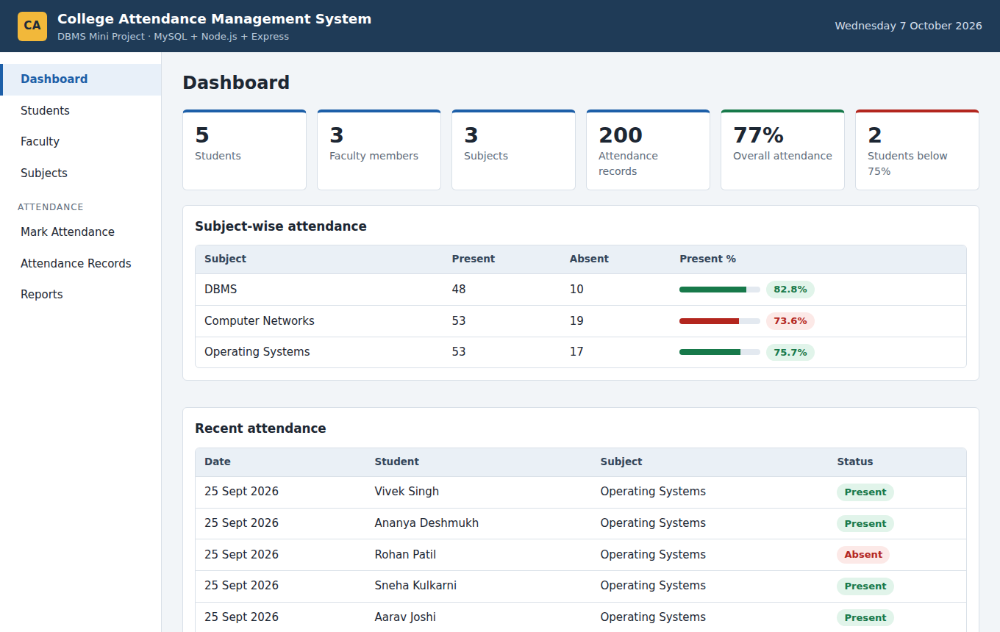

# College Attendance Management System

**DBMS Mini Project** built with **MySQL + Node.js + Express** and a simple HTML/CSS/JavaScript front end.

The system stores students, faculty, subjects and daily attendance in a relational MySQL database. Teachers can mark attendance for a whole class in one click, and the reports show attendance percentage, subject-wise summary and students with low attendance.



## Features

- **Dashboard:** totals, overall attendance %, students below 75%, subject-wise summary, recent attendance.
- **Students, Faculty, Subjects:** add, edit, delete and search (full CRUD).
- **Mark Attendance:** choose subject and date, mark Present or Absent for the whole class, save in one transaction. Saving the same day again updates it.
- **Attendance Records:** filter by subject, date or student; correct a status or delete a record.
- **Reports:** student-wise percentage (from a SQL view), subject-wise present/absent summary, low-attendance list with a changeable limit, per-student report card, export to CSV, print.

More screenshots are in the `screenshots` folder.

## DBMS concepts used

| Concept | Where |
|---|---|
| Tables, primary keys, AUTO_INCREMENT | `database/schema.sql` |
| Foreign keys with `ON DELETE CASCADE` / `SET NULL` | `subjects.faculty_id`, `attendance.student_id`, `attendance.subject_id` |
| Constraints: `NOT NULL`, `UNIQUE`, `CHECK`, `DEFAULT`, `ENUM` | all tables; `UNIQUE (student_id, subject_id, attendance_date)` stops duplicate attendance |
| CRUD (INSERT, SELECT, UPDATE, DELETE) | `routes/students.js`, `faculty.js`, `subjects.js`, `attendance.js` |
| INNER JOIN, LEFT JOIN | `routes/attendance.js`, `routes/reports.js`, `database/queries.sql` |
| GROUP BY, COUNT, SUM, ROUND, HAVING | `routes/reports.js`, `database/queries.sql` |
| VIEW | `student_attendance_summary` (used by the Reports page) |
| TRIGGER | `trg_block_future_attendance` blocks attendance for a future date |
| TRANSACTION (COMMIT / ROLLBACK) | `POST /api/attendance/bulk` saves a whole class or nothing |

ER diagram (same as the report): `FACULTY 1:M SUBJECTS 1:M ATTENDANCE M:1 STUDENTS`

## What you need

- [Node.js](https://nodejs.org) 18 or newer
- [MySQL Server](https://dev.mysql.com/downloads/mysql/) **8.0.16 or newer** (older versions ignore `CHECK` constraints)
- VS Code (any editor works)

## How to run in VS Code

1. Open this folder in VS Code (File > Open Folder).
2. Open the terminal (Ctrl + `) and install the packages:
   ```
   npm install
   ```
3. Copy `.env.example` to a new file named `.env` and put your MySQL password in it:
   ```
   DB_PASSWORD=your_mysql_password
   ```
4. Create the database, tables, view, trigger and sample data (one time):
   ```
   npm run setup
   ```
   Use `npm run setup:demo` instead if you want extra attendance records so the percentages and the low-attendance report look realistic.
5. Start the project:
   ```
   npm start
   ```
6. Open **http://localhost:3000** in the browser.

> `npm run setup` **drops and recreates** the database `college_attendance`. Do not run it again if you want to keep your data.

### Using MySQL Workbench instead of `npm run setup`

Open and run these files in order: `database/schema.sql`, then `database/sample_data.sql`. Practice queries (joins, view, trigger test, transactions) are in `database/queries.sql`.

## Project structure

```
College_Attendance_Management_System/
├── server.js                  Express server
├── config/db.js               MySQL connection pool
├── routes/                    API: students, faculty, subjects, attendance, reports, dashboard
├── middleware/errorHandler.js Friendly error messages (duplicate roll number, trigger error, ...)
├── utils/helpers.js           Validation helpers
├── database/
│   ├── schema.sql             Tables, view and trigger
│   ├── sample_data.sql        Records used in the report
│   ├── extra_demo_data.sql    Optional extra attendance
│   └── queries.sql            Important queries for viva
├── scripts/setup-db.js        Runs the SQL files (npm run setup)
├── public/                    Front end (index.html, css, js)
└── screenshots/
```

## API

| Method | URL | Purpose |
|---|---|---|
| GET | `/api/health` | Check the database connection |
| GET | `/api/dashboard` | Totals, subject summary, recent attendance |
| GET, POST | `/api/students` | List (with `?search=`) / add |
| PUT, DELETE | `/api/students/:id` | Edit / delete |
| GET | `/api/students/:id/attendance` | Subject-wise report card |
| GET, POST | `/api/faculty` | List / add |
| PUT, DELETE | `/api/faculty/:id` | Edit / delete |
| GET, POST | `/api/subjects` | List / add |
| PUT, DELETE | `/api/subjects/:id` | Edit / delete |
| GET | `/api/attendance` | Records (`?subject_id=&date=&search=`) |
| GET | `/api/attendance/sheet` | Class list for a subject and date |
| POST | `/api/attendance/bulk` | Save a whole class (transaction) |
| PUT, DELETE | `/api/attendance/:id` | Correct status / delete |
| GET | `/api/reports/student-summary` | Percentage per student (view) |
| GET | `/api/reports/subject-summary` | Present / absent per subject |
| GET | `/api/reports/low-attendance?threshold=75` | Students below the limit |

## Troubleshooting

| Problem | Fix |
|---|---|
| "Cannot reach the database" on the page | Start the MySQL service, check `DB_PASSWORD` in `.env`, run `npm run setup` once |
| `Access denied for user 'root'` | Wrong `DB_USER` or `DB_PASSWORD` in `.env` |
| `Setup failed ... ECONNREFUSED` | MySQL is not running |
| Port 3000 already in use | Change `PORT` in `.env` |
| Semester above 8 is accepted | Your MySQL is older than 8.0.16; upgrade MySQL |

## Upload to GitHub

```
git init
git add .
git commit -m "College Attendance Management System - DBMS mini project"
git branch -M main
git remote add origin https://github.com/<your-username>/college-attendance-management-system.git
git push -u origin main
```

The `.env` file (with your password) is listed in `.gitignore`, so it is not uploaded.

## Technologies

MySQL, SQL, Node.js, Express, mysql2, HTML, CSS, JavaScript.
